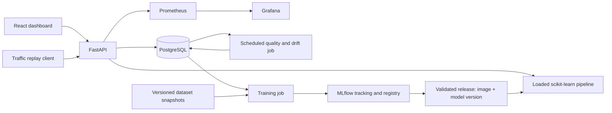

# SpamWatch: ML engineering project plan

Build a real-time spam classification platform that demonstrates the full model lifecycle: training, serving, feedback, monitoring, retraining, release, and rollback.

Planning assumption: one developer, 10–15 hours per week, approximately 8–10 weeks. These are estimates; allow additional time if FastAPI, React, Docker, and AWS are all new. Complete the local MVP before adding cloud infrastructure.

## 1. Product scope

A user submits a message and receives a spam decision, score, prediction ID, and model version. An operator can review recent predictions, supply labels, inspect model quality and system health, investigate drift, and release a validated model.

Start with English SMS spam classification. Treat spam as the positive class. Use a replay client to simulate incoming traffic and delayed ground-truth labels. Clearly label replay traffic and synthetic perturbations in the dashboard and project documentation.

The initial release includes synchronous REST inference and a dashboard that refreshes every few seconds. Kafka, Kubernetes, fraud detection, and transformer training are later extensions if the finished system exposes a concrete need.

## 2. Architecture and stack



| Area | Choice | Purpose |
| --- | --- | --- |
| Frontend | React, TypeScript, Vite, Recharts | Prediction form, feedback queue, quality and drift views |
| API | FastAPI, Pydantic | Validated REST contracts and inference |
| Model | scikit-learn TF-IDF + logistic regression | CPU baseline with a probability score |
| Database | PostgreSQL, SQLAlchemy, Alembic | Prediction records, labels, monitoring summaries, migrations |
| Experiments and registry | MLflow | Parameters, metrics, artifacts, model versions and lineage |
| Operational monitoring | Prometheus and Grafana | Request rate, failures, latency and resource health |
| ML monitoring | Scheduled Python job with Evidently | Drift reports and labeled quality summaries |
| Local runtime | Docker Compose | Repeatable service startup |
| CI/CD | GitHub Actions | Tests, builds, training workflow and deployment checks |
| Cloud | AWS | Container deployment, managed PostgreSQL, artifact storage |

Use scikit-learn for the first complete release. Add a small PyTorch text classifier only after the system works; compare quality, model size, memory, training cost, and latency before deciding whether to deploy it.

Load the complete preprocessing and classifier pipeline once at startup. Run inference in the API process; MLflow stores and tracks artifacts rather than sitting on every prediction's network path. Use separate databases and credentials for application records and MLflow metadata, even if local development shares one PostgreSQL server.

## 3. Milestones

### Phase 1 — Data and reproducible baseline: week 1

- Start with the [UCI SMS Spam Collection](https://archive.ics.uci.edu/dataset/228/sms+spam+collection). Record its source, license, download checksum, and actual parsed row count.
- Validate labels, blank messages, encoding, duplicates, and class imbalance.
- Group duplicate and near-duplicate messages before assigning approximately 70/15/15 train/validation/test splits. Keep related messages in the same split and report actual split sizes.
- Keep an independent replay/demo pool; do not return final test examples to retraining or replay. If the corpus becomes too small, collect a separate labeled evaluation set.
- Fit TF-IDF only on training data inside a scikit-learn Pipeline. Compare majority-class, multinomial naive Bayes, and logistic regression baselines.
- Select the decision threshold on validation data. Report spam precision, recall, F1, PR-AUC, confusion matrix, and false-positive examples.
- Save the pipeline, threshold, split manifest, dataset hash, seed, dependency lockfile, and experiment configuration.

Done when a single training command reproduces the same split and comparable metrics, and a saved pipeline predicts on unseen input. Scikit-learn documents why preprocessing must be fitted only on training data in its [data leakage guidance](https://scikit-learn.org/stable/common_pitfalls.html).

Suggested quality goals are precision ≥ 0.95 and recall ≥ 0.85 on validation data. Treat these as goals to evaluate, not promised results. If no threshold meets both, document the tradeoff. Keep the final test set sealed until the release candidate is chosen; do not repeatedly use it as the retraining promotion gate.

### Phase 2 — FastAPI and persistence: week 2

Implement these contracts:

| Endpoint | Behavior |
| --- | --- |
| `POST /api/v1/predictions` | Accept message; return prediction ID, label, spam probability, threshold, model version, and inference duration |
| `POST /api/v1/feedback` | Attach an authorized human label to a prediction ID |
| `GET /api/v1/predictions` | Paginated, filterable history |
| `GET /api/v1/monitoring/quality` | Time-windowed labeled metrics and label coverage |
| `GET /api/v1/monitoring/drift` | Latest report, reference version, window, and sample count |
| `GET /health/live` | Process liveness |
| `GET /health/ready` | Required model and database readiness |
| `GET /metrics` | Internal Prometheus metrics |

Use tables for predictions, feedback events, model release metadata, monitoring windows, and training jobs. Predictions should include timestamps, model version, threshold, score, predicted class, input descriptors, inference duration, and traffic source. Feedback should include label source, label timestamp, and revision history. Define which label revision is authoritative when computing quality.

For the MVP, persist each prediction before returning success. Return an explicit service error if persistence fails; measure database time separately from inference. Give replay requests an idempotency key so retries do not inflate traffic counts.

Bound input length and request size, validate malformed input, and handle unavailable model/database states. Store raw messages only under an explicit retention policy; avoid raw content in operational logs. Keep message text and prediction IDs out of Prometheus labels.

Done when a REST request runs the saved model, writes a versioned record, and accepts linked feedback, with integration tests against PostgreSQL.

### Phase 3 — Local MVP and user interface: week 3

- Build a message submission form showing prediction, score, model version, and response time. Describe the score as model-estimated rather than guaranteed confidence.
- Add prediction history, filters, and a protected labeling queue.
- Add dashboard cards for traffic, spam share, model version, latency, quality, label coverage, and drift status. Show unavailable values as unavailable rather than zero.
- Containerize the frontend and API; add PostgreSQL and database migrations to Compose.
- Provide documented commands for setup, baseline training, migrations, startup, and seeded demo traffic.

Done when a fresh checkout can reach the UI, submit a message, inspect the database-backed result, and provide feedback using the documented commands. This is the MVP checkpoint.

### Phase 4 — MLflow and release lineage: week 4

- Run MLflow with PostgreSQL metadata and persistent local artifact storage; use S3 for cloud artifacts.
- Log data hashes, code commit, parameters, split manifest, threshold, metrics, model signature, reference-data descriptors, and serialized pipeline.
- Register candidate models and use aliases such as `candidate` and `champion`. MLflow supports named aliases for registered versions in its [registry workflow](https://www.mlflow.org/docs/latest/ml/model-registry/workflow/).
- On release, resolve an alias to an immutable model version and record that exact version and artifact checksum alongside the container image digest and threshold.
- Fail readiness on model/schema incompatibility. Keep the previous release manifest for rollback. Separate the desired registry alias from the actual version served by each replica.

Done when two model versions can be compared and the service can deploy either version while preserving a complete release record.

### Phase 5 — Monitoring and replay: week 5

Track three distinct categories:

1. Operational: model-only latency, full server request latency, p50/p95/p99, requests per second, failures, database write time, and memory. Measure browser-observed latency separately.
2. Model quality: spam precision/recall/F1, confusion matrix, PR-AUC where both classes are present, label coverage, and label delay. Group by prediction time and model version; recompute windows as labels arrive. Show class counts, sample counts, and uncertainty for small samples.
3. Drift and data quality: compare current windows with the versioned reference dataset using text length, URL frequency, digit share, vocabulary coverage, score distribution, and missing/invalid input rates.

Precision, recall, and F1 require ground-truth labels. With only selectively reviewed messages, describe the result as quality on the reviewed subset. Add a randomly sampled labeling stream for a less biased estimate. Never treat model predictions as their own truth labels.

Use Evidently to compare current and reference distributions; its [drift documentation](https://docs.evidentlyai.com/metrics/explainer_drift) explains reference/current inputs and statistical methods. Set explicit sample minimums and calibrate alert thresholds using unchanged and shifted demo windows. Drift is an investigation signal; it does not establish that model quality has fallen.

Build a replay client with steady traffic, a burst, controlled text perturbations, and delayed label delivery. Keep perturbed samples separate from the headline benchmark and verify their labels if used for quality evaluation.

Done when dashboards distinguish system health, labeled model quality, and unlabeled drift; a reproducible simulation triggers a drift alert without retraining automatically on unverified data.

### Phase 6 — Automated training and promotion: week 6

Create a reusable pipeline:

```text
Snapshot trusted labeled data → validate → deduplicate and split
→ train → evaluate candidate against champion → register candidate
→ quality/latency gates → release → smoke test → rollback if needed
```

- Trigger it manually and on a weekly schedule with GitHub Actions; drift can create a retraining-needed record.
- Require a configured minimum of new trusted labels and sufficient class support. Snapshot exact input IDs/checksums and exclude protected evaluation and replay-only data.
- Persist training status, failure reason, MLflow run ID, input version, and output model version.
- Compare both models on the same independent promotion cohort. Use a fresh or rotating cohort for repeated promotions so one benchmark does not become a tuning set.
- Define configurable gates: required precision floor, recall/F1 tolerance relative to champion, schema compatibility, and latency budget. Insufficient labels or failed gates retain the current deployment.
- Automate candidate creation and validation. Start with an explicit protected release action for promotion; introduce automatic promotion only after release and rollback are reliable.

Done when a run creates a traceable candidate, a deliberately poor candidate fails its gate, and a released version can be rolled back without losing prediction history.

### Phase 7 — Tests, CI and performance: week 7

Add meaningful checks as each feature is built; this week consolidates them:

- Unit tests: input validation, split leakage, feature transformations, threshold behavior, known confusion-matrix metrics, and serialization compatibility.
- PostgreSQL integration tests: migrations, prediction writes, feedback revisions, and metric aggregation.
- API and model contracts: invalid input, readiness, missing model, model version attribution, and idempotent retries.
- Pipeline tests: reproducible manifests, insufficient-data skip, rejected candidate, and rollback.
- Frontend smoke test: submit → view result → label → inspect updated quality.
- GitHub Actions: Python lint/type checks, backend tests, frontend checks/build, image builds, and a Compose smoke test. Keep full training out of every pull request; use a tiny fixture for CI contracts.
- Load test with k6 or Locust and publish hardware, worker count, corpus, concurrency, warm-up, duration, throughput, errors, and latency percentiles.

Initial performance goal: warmed server p95 request latency below 150 ms at 20 requests/second for five minutes, with errors below 1%, on explicitly documented hardware. This includes persistence and excludes cold starts. Revise the target after the baseline and report measured results honestly.

Done when CI gates changes and the repository contains a reproducible benchmark report.

### Phase 8 — AWS deployment and portfolio: weeks 8–10

Recommended managed deployment:

| Component | AWS service |
| --- | --- |
| React static assets | S3 behind CloudFront |
| API container | ECS Fargate behind an Application Load Balancer |
| PostgreSQL | RDS PostgreSQL in private networking |
| Container images | ECR |
| Dataset snapshots, models, reports | Private S3 buckets |
| MLflow | Private service with durable metadata/artifact storage |
| Training and monitoring jobs | Scheduled or explicitly triggered ECS tasks |
| Logs and operational alerts | CloudWatch; retain Grafana for the project dashboards |
| Deployment configuration | Terraform or another reproducible infrastructure definition |

AWS documents [ECS load balancing](https://docs.aws.amazon.com/AmazonECS/latest/developerguide/service-load-balancing.html) and [RDS PostgreSQL](https://docs.aws.amazon.com/AmazonRDS/latest/UserGuide/CHAP_PostgreSQL.html). Estimate regional costs before provisioning; managed databases, load balancers, and networking can have ongoing charges without demo traffic. A single EC2 host running Compose is a smaller demo alternative, with documented availability and durability limits.

Use HTTPS, restricted CORS, protected feedback/admin actions, rate limits for public inference, managed secrets, private registry/metrics access, least-privilege IAM, and GitHub Actions OIDC for deployment. Prevent secrets from entering the React bundle. Keep public demo submissions out of training until trusted review.

Deploy an immutable image/model pair, run migrations safely, check readiness and a known prediction, and retain the previous pair for rollback. Document backup/restore and infrastructure teardown.

Done when another person can use the deployed demo, CI can release a version, and you can demonstrate recovery from a failed release.

## 4. Suggested repository layout

```text
frontend/                  React application
backend/app/               FastAPI routes, inference, persistence
backend/migrations/        Alembic migrations
ml/                        Dataset validation, training, evaluation
monitoring/                Quality jobs, drift jobs, dashboard definitions
scripts/                   Traffic replay and delayed labels
tests/                     Unit, integration, and end-to-end checks
infra/                     Dockerfiles, Compose, cloud definitions
configs/                   Training, monitoring, and release configuration
docs/                      Architecture, model card, benchmarks, runbook
.github/workflows/         CI, training, deployment
```

Keep bulky data and model binaries out of Git. Commit dataset manifests, report summaries, dependency locks, and infrastructure definitions. Ignore local credentials and generated artifacts.

## 5. Final demonstration and resume evidence

Record a short walkthrough: submit messages → inspect persisted predictions → replay shifted traffic → observe drift → deliver delayed labels → show quality and coverage → train a candidate → inspect its MLflow lineage → reject or release it → roll back.

Publish a clear README, architecture diagram, model card, benchmark report, CI status, dashboard screenshots, deployment instructions, and a short incident/runbook example. Explain the limits of the small historical corpus and simulated production traffic.

Use measured resume claims only, for example:

> Built and deployed a versioned spam detection platform using React, FastAPI, scikit-learn, PostgreSQL, Docker, and AWS; achieved [measured F1] and [measured p95] at [measured throughput], with MLflow tracking, delayed-label quality monitoring, drift detection, and gated retraining.

First concrete task: finish Phase 1 and record the dataset/split manifest and baseline results before building the dashboard.

## 6. Autonomous system extension

Reframe the finished product as an autonomous ML operations system for spam detection. Its objective is to maintain specified quality and latency targets within a training and deployment budget. The operating loop is:

```text
Observe → assess evidence → select an allowed action → execute
→ verify the outcome → retain, roll back, wait, or escalate
```

A training schedule automates a task. The controller adds decisions about whether training is justified, what evidence is missing, whether a candidate should receive traffic, and whether the change improved the system. Human labeling remains an external dependency; autonomy includes recognizing when evidence is insufficient.

### Controller architecture

Add a Python controller and job worker alongside FastAPI. Let the controller poll monitoring summaries initially; later, completed monitoring jobs can also emit events. Keep a durable state machine and job queue in PostgreSQL. GitHub Actions still handles CI and builds; the controller owns operational decisions and records their results.

Persist incidents, evidence snapshots, policy versions, decisions, actions, attempts, leases, release transitions, and outcomes. Each action needs an idempotency key, timeout, bounded retry policy, and restart recovery. Use a transactional job claim and a single active release lease per environment to prevent competing controllers from deploying different versions. Reconcile the recorded state against the versions actually serving traffic after a restart.

Suggested states:

```text
HEALTHY → INVESTIGATING → WAITING_FOR_LABELS / TRAINING
TRAINING → EVALUATING → SHADOW → CANARY → VERIFYING → HEALTHY
Any executing state → FAILED / ROLLING_BACK / ESCALATED
```

Persist the transition reason and evidence. Waiting, rejecting a candidate, and escalating can all be correct outcomes; do not treat every incident as a reason to change a model.

### Decision policy

Store policies in versioned configuration and test their behavior with historical and simulated incidents. The following are policy examples, not established statistical thresholds:

| Observation | Autonomous response | Verification or stop condition |
| --- | --- | --- |
| Drift persists across sufficiently populated windows | Open an investigation; select representative, novel, and uncertain messages for labeling | Await trusted labels; preserve a separate random audit sample |
| Quality degradation with adequate labeled class counts | Snapshot new trusted data and train a bounded set of candidates | Stop if label evidence, data quality, or budget is insufficient |
| Invalid or missing inputs spike | Quarantine affected records from training; record a data-quality incident | Keep healthy records flowing; escalate unresolved upstream issues |
| Candidate passes independent offline gates | Deploy shadow inference, then a small randomized canary | Confirm compatibility, error rate, latency, and sufficient labeled evidence |
| Canary violates operational or labeled quality gates | Restore the previous release and record the failure | Verify restored version and service health; escalate unsuccessful recovery |
| Latency rises while model quality is stable | Diagnose model time versus database/request time; scale API within configured limits when capacity is the cause | Verify sustained recovery; stop at capacity/cost limits |
| Repeated attempts fail or telemetry becomes stale | Stop further model changes and open an escalation record | Resume only when the recorded dependency or policy condition is resolved |

Uncertainty sampling supplies useful training examples but biases the labeled population. Keep the random audit stream separate for quality estimation. Confidence-based routing requires checking calibration; a raw logistic regression score alone does not establish a reliable abstention threshold.

### Autonomous release and recovery

1. Compare candidate and champion on the same independent promotion cohort; require enough examples of both classes and account for uncertainty.
2. Run shadow predictions on copied inputs without affecting user responses. Check model loading, schema, operational cost, and later labeled quality; agreement with the champion is diagnostic, not ground truth.
3. Route a small random fraction of real requests to the candidate. Record assignment and served model version, and choose the sample requirement and evaluation rule before the experiment.
4. Expand traffic only after operational and quality gates pass. Low traffic or delayed labels should leave the candidate waiting, rather than trigger promotion after an arbitrary time limit.
5. Roll back on defined regression conditions and verify the old release is actually healthy. If recovery fails, pause releases and escalate.

MLflow aliases identify candidates and champions; the controller must implement traffic routing, evidence checks, and release reconciliation. Infrastructure health checks alone do not measure classifier precision or recall. AWS provides [ECS deployment failure detection and rollback](https://docs.aws.amazon.com/AmazonECS/latest/developerguide/deployment-failure-detection.html), while model-quality recovery needs application-level monitoring and policy.

### Bounded authority

Begin in observation-only mode, then enable candidate training and shadow evaluation, then canary releases and automatic rollback in the demo environment. Enable wider automatic promotion only after the failure scenarios pass. This extends the protected-release starting point in Phase 6.

Configure maximum training runs per day, maximum concurrent jobs, a cooldown between releases, maximum canary exposure, a compute budget, and a pause switch. Reject contaminated labels and incompatible artifacts. Store and restore the entire image/model/threshold configuration. If a release changes the database, its migration must remain compatible with the previous release used for rollback.

An optional LLM can summarize incident evidence, retrieve an approved runbook, and propose an allowlisted action with cited evidence IDs. Keep policy checks and action execution deterministic. The controller should remain functional if the LLM is unavailable, and untrusted message text must not act as controller instructions. An LLM is an extension; the observable control loop is the core autonomous behavior.

### Dashboard and evaluation

Add an incident timeline showing observations, selected actions, policy rationale, current workflow state, active model, budget consumption, and verified outcomes. Include pause/resume and an escalation queue so autonomy is inspectable.

Create repeatable scenarios: steady traffic requiring no action; drift without labels; drift followed by sufficient trusted labels; a worse candidate; a slow canary; duplicate events; a controller crash during release; and unavailable monitoring or database dependencies.

Measure detection delay, verified recovery time, unnecessary retraining rate, useful candidate promotion rate, operational/model regressions, compute cost per recovery, and manual interventions. Define recovery as meeting the configured targets for a specified observation window. Report policy violations and failed recoveries, not just successes.

The strongest demo shows a complete verified recovery plus a case where the controller correctly waits or rejects an action. Use pre-labeled, independently held-out replay data to simulate delayed labels, and disclose that simulation explicitly.

### Revised delivery sequence

Keep Phases 1–5. Extend Phase 6 with durable decisions and automatic candidate evaluation; add shadow/canary routing and recovery in Phases 7–8. Plan approximately 3–5 additional weeks for a tested autonomous extension, depending on experience and infrastructure scope. Deliver the controller in stages rather than adding every recovery mechanism at once.

Final positioning: **an autonomous spam detection platform that monitors its operating conditions, gathers evidence, retrains and validates candidates, deploys bounded experiments, and verifies or reverses its own changes.**
