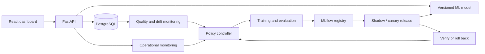

# SpamWatch

An autonomous ML operations platform for real-time spam detection, built incrementally from a reproducible classifier to monitored serving, evidence-driven retraining, and verified recovery.

**Status: initial scaffold.** The API and React status page run locally. Classification, database integration, monitoring, training, cloud deployment, and the autonomous controller are planned. This repository does not yet classify messages or take autonomous actions.

## Project goal

Maintain spam detection quality and inference latency within configured limits. When operating conditions change, the system will gather evidence, evaluate an allowed response, execute it, and verify the outcome. Insufficient labels should cause it to wait; a failing release should trigger recovery.



The diagram describes the target architecture. See the [implementation status](docs/IMPLEMENTATION_STATUS.md) for what exists today and the [project plan](PROJECT_PLAN.md) for milestones and completion criteria.

## Stack

| Area | Initial choice | Status |
| --- | --- | --- |
| Frontend | React, TypeScript, Vite | Runnable status page |
| Backend | FastAPI, Pydantic | Health and project-status endpoints |
| Model | scikit-learn, TF-IDF, logistic regression | Planned |
| Persistence | PostgreSQL, SQLAlchemy, Alembic | Local PostgreSQL container configured; API integration planned |
| Model lifecycle | MLflow | Planned |
| Monitoring | Prometheus, Grafana, Evidently | Planned |
| Autonomy | Python controller, durable PostgreSQL workflows | Planned |
| Delivery | Docker Compose, GitHub Actions, AWS | Local container definitions and CI configured; cloud deployment planned |

## Run locally

Prerequisites: Python 3.11 and Node.js 22.12 or newer in the Node 22 release line. Use `nvm use` if you manage Node with nvm. Run all commands from the repository root unless specified otherwise.

Set up the backend:

```bash
python3 -m venv .venv
.venv/bin/python -m pip install -r backend/requirements-dev.txt
.venv/bin/python -m uvicorn spamwatch.main:app --app-dir backend/src --reload
```

In a second terminal, start the frontend:

```bash
npm --prefix frontend ci
npm --prefix frontend run dev
```

Open [the frontend](http://localhost:5173) and [the API documentation](http://localhost:8000/docs). Vite proxies `/api` requests to FastAPI. No cloud account, model artifact, database, or credentials are required for this initial shell.

## Run with Docker

Requires Docker Engine and the Docker Compose plugin, or Docker Desktop.

```bash
cp .env.example .env
docker compose up --build
```

Open [the containerized frontend](http://localhost:8080) and [the API documentation](http://localhost:8000/docs). PostgreSQL runs on the internal Compose network with a named volume; the API does not use it yet. The frontend's Nginx server proxies `/api` requests to the API container.

```bash
docker compose down
```

Stopping the stack preserves the database volume. The example credentials are for local development. Public deployment and authentication are future milestones.

## API available today

| Endpoint | Behavior |
| --- | --- |
| `GET /health/live` | HTTP 200 when the API process responds |
| `GET /health/ready` | HTTP 503: model serving and persistence are not implemented |
| `GET /api/v1/status` | Explicit implementation status; autonomous actions are disabled |

Liveness does not indicate model-serving readiness. There is intentionally no prediction endpoint until a real model can serve it.

## Development checks

```bash
.venv/bin/python -m ruff check backend
.venv/bin/python -m ruff format --check backend
.venv/bin/python -m pytest
npm --prefix frontend run typecheck
npm --prefix frontend run build
```

`make check` runs the same checks after dependencies are installed. GitHub Actions runs backend and frontend checks and validates/builds the Docker configuration on pushes and pull requests. These workflows check the scaffold; they do not train models or deploy infrastructure.

## Repository map

```text
backend/                 FastAPI shell, Python dependencies, API tests
frontend/                React status page and Vite/Nginx configuration
controller/              Autonomous controller design
ml/                      Baseline and evaluation implementation notes
monitoring/              Monitoring contracts and metric definitions
configs/                 Proposed controller policy; not consumed by code yet
data/                    Dataset handling instructions; datasets are ignored
docs/                    Architecture, implementation status, contribution guide
.github/workflows/       Continuous integration
compose.yaml             Local frontend, API, and PostgreSQL services
PROJECT_PLAN.md          Build milestones and autonomous-system extension
```

## Build order

1. Validate and version the SMS dataset; build a reproducible baseline.
2. Add actual inference, prediction persistence, and trusted feedback.
3. Track experiments and immutable releases with MLflow.
4. Add operational metrics, delayed-label quality monitoring, and drift detection.
5. Implement the controller in observation-only mode, then bounded training.
6. Add shadow/canary releases, verified rollback, and failure-scenario tests.
7. Deploy to AWS and publish measured results and a recorded demonstration.

Use the [contribution guide](CONTRIBUTING.md) and [architecture notes](docs/ARCHITECTURE.md) when extending the scaffold. The first implementation milestone is the [reproducible baseline](ml/README.md).
# Spam-Detection-System
